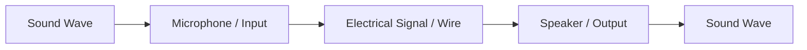
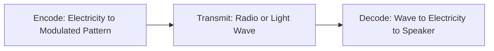
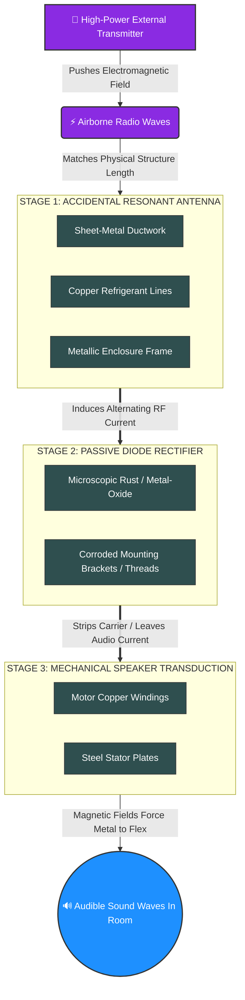
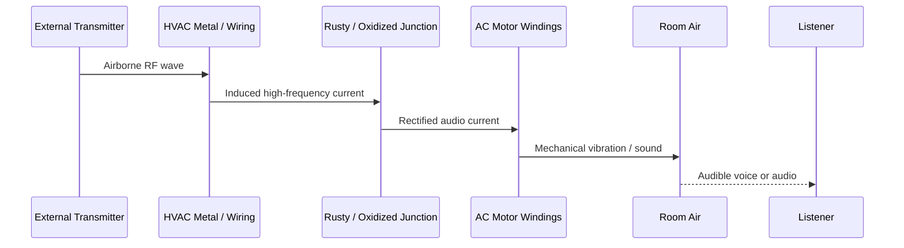
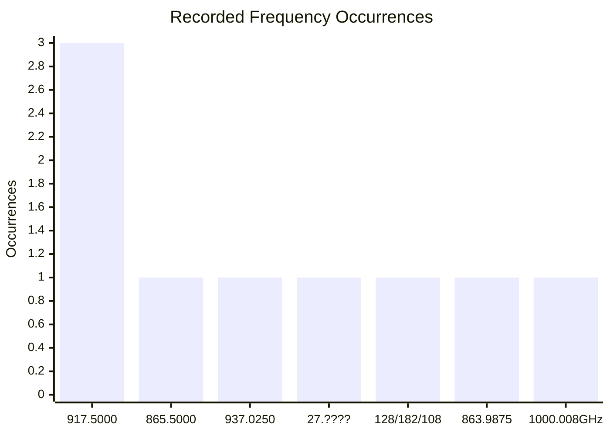
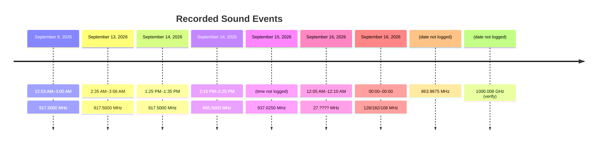
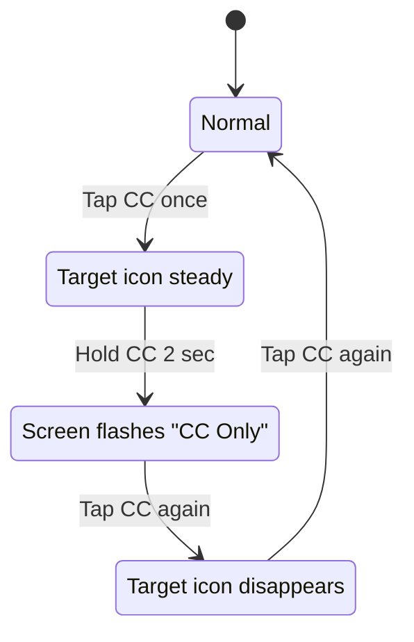
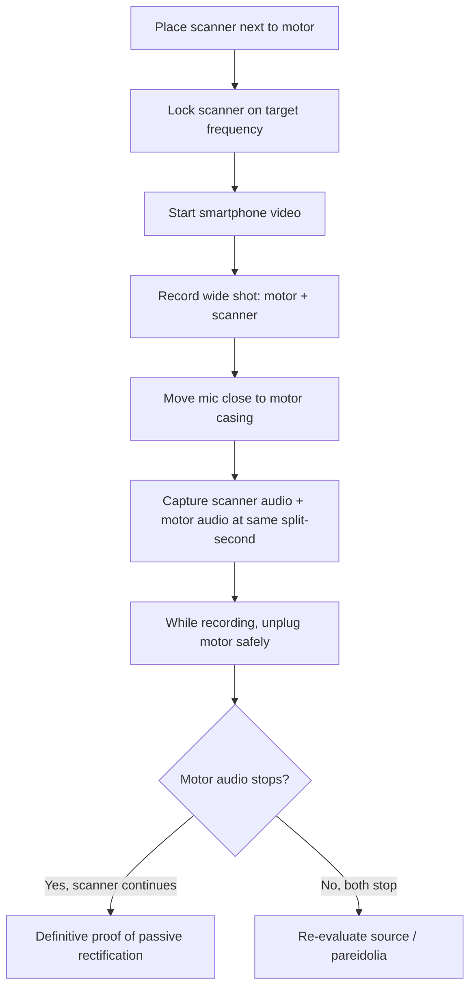
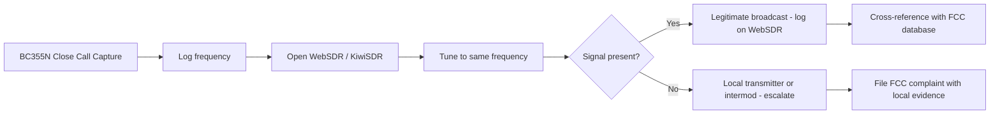

# 📡 ELECTROMAGNETIC-AUDIO-TRANSDUCTION-AND-DEMODULATION
### Passive RF Rectification, “Rusty Bolt” Audio, Unintentional Radiators, and Uniden BC355N Field Operations

[]()
[]()
[]()
[]()
[]()
[]()

> [!NOTE]
> - **ICC 3086-2026**
> - **Last Updated:** September 16, 2026

> [!WARNING]
> - **This research and report is done by a real person hearing this for real. Hearing a whole conversation next to a HVAC unit with no one there makes you feel crazy until you take a read — everything in the repo below is actually real, researched, documented and needs reported because people have been illegally breaking the law for the longest time. Email is down in the repo below — contact me and I'll give you the source and who they are.**
> - **764 and various NVE groups are using these techniques to harass people without getting caught, and avoid detection from the FBI. They will put walkie-talkies around your house without you knowing about it. If you pick it up with the scanner listed below, report it ASAP to the FBI. They target autistic people and people with pets. Urban legends would call these rooms "Red Rooms."**

> **Repository concept:** `DuckyOnQuack-999/ELECTROMAGNETIC-AUDIO-TRANSDUCTION-AND-DEMODULATION`
> **Purpose:** Document the theory, field logs, scanner procedures, evidence capture, regulatory reporting, unintentional radiator regulations, range analysis, and equipment requirements for a reported case of an unmodified AC motor/HVAC chassis producing intelligible audio via passive RF rectification.

---

> [!WARNING]
> **Safety, Legal, and Scope Notice**
> - Do not open, modify, or touch energized AC equipment. Use a licensed electrician for any mains wiring, grounding, or motor work.
> - This repository is for informational, diagnostic, and documentation purposes only. It is not legal, medical, or engineering advice.
> - Many apparent “voices from appliances” are **auditory pareidolia**, local audio leakage, or mechanical noise. This repo provides methods to distinguish real RF demodulation from pareidolia.
> - Frequency numbers in early notes may have been captured during broad scans and are not automatically confirmed sources. Treat all frequencies as **observations until verified**.
> - Do not confront suspected transmitter operators yourself.
> - **Transmitting on radio frequencies without a license is illegal** and can result in massive fines and criminal penalties. The equipment descriptions in this repo are for educational purposes only.

---

## 📚 Table of Contents

1. [Executive Summary](#-executive-summary)
2. [Scientific Foundations](#-scientific-foundations)
   - [Electricity Around Us](#1-is-there-electricity-around-us-at-all-times)
   - [Electricity to Transfer Audio](#2-using-electricity-to-transfer-audio)
   - [Wireless Audio Through Air](#3-wireless-audio-through-the-air)
   - [Crosstalk From an AC Motor](#4-crosstalk-from-an-ac-motor)
   - [How an AC Motor Intensifies Audio](#5-how-an-ac-motor-intensifies-audio-over-electricity)
   - [Turning a Motor Into a Speaker](#6-turning-a-motor-into-a-speaker)
   - [Miles Away vs. Right Next to You](#7-unmodified-motor-miles-away-vs-right-next-to-you)
   - [Can Anyone Hear This?](#8-can-a-normal-non-autistic-person-hear-this)
3. [Passive Intermodulation / “Rusty Bolt” Effect](#-passive-intermodulation--rusty-bolt-effect)
4. [Range Analysis & Propagation](#-range-analysis--propagation)
5. [Unintentional Radiators & FCC Part 15](#-unintentional-radiators--fcc-part-15)
6. [Equipment for Recreating the Effect](#-equipment-for-recreating-the-effect)
7. [Full System Transduction Diaphragm](#-full-system-transduction-diaphragm)
8. [Observation Logs & Telemetry](#-observation-logs--telemetry)
9. [Hardware Manual: Uniden BC355N](#-hardware-manual-uniden-bc355n)
10. [Web-Based Scanner Alternatives](#-web-based-scanner-alternatives)
11. [Field Operations Guides](#-field-operations-guides)
12. [Evidence Capture Protocol](#-evidence-capture-protocol)
13. [Regulatory & Law Enforcement Reporting](#-regulatory--law-enforcement-reporting)
14. [Electric Utility Company Contact Directory](#-electric-utility-company-contact-directory)
15. [Physical Mitigation](#-physical-mitigation)
16. [AI Research Prompt](#-ai-research-prompt)
17. [Appendices](#-appendices)

---

## 🧭 Executive Summary

This repository merges the entire research thread into one field-ready document.

Key conclusions:

- **Electricity is everywhere** — in the atmosphere, inside matter, and inside the human body.
- **Audio can be transferred by electricity** — microphones convert sound to electrical signals; speakers convert them back.
- **Audio can be transferred wirelessly through air** — via radio waves, infrared light, or laser beams.
- **AC motors can cause crosstalk** — through magnetic induction, dirty power, and ground loops.
- **A motor can be turned into a speaker** — by feeding amplified audio into its coils and using its casing as a diaphragm.
- **An unmodified motor miles away cannot transmit audio** — but an unmodified motor **right next to you** may accidentally demodulate strong RF via the “Rusty Bolt” effect, or the sound may be pareidolia.
- **Anyone can experience this** — neurotypical and autistic people alike.
- **The Uniden BC355N** is the field scanner used here. It is DC-powered, covers 25–956 MHz, and has Close Call RF Capture.
- **Web-based scanner alternatives** (WebSDR, KiwiSDR, OpenWebRX+, BrowSDR) provide clearer waterfall displays and can complement the BC355N for remote monitoring and verification.
- **462.8875 MHz was not the target** — it was a baseline scan capture. The logged target observations include **917.5000 MHz**, **865.5000 MHz**, **937.0250 MHz**, **27.???? MHz**, **128.0000/182.0000/108.0000 MHz**, **863.9875 MHz**, and **1000.008 GHz** (see logs for verification status).
- **917.5000 MHz** is in the 902–928 MHz ISM band. It is usually digital data, but analog voice can appear from older cordless phones, baby monitors, wireless mics, or illegally amplified Part 15 gear.
- **865.5000 MHz** is logged as a spectral shift capture. If voices are heard here that sound like harassment or role-play, report immediately to the agencies listed in [Regulatory & Law Enforcement Reporting](#-regulatory--law-enforcement-reporting).
- **937.0250 MHz** is logged as an additional capture. It sits **outside** the standard ISM band and likely belongs to a different service class.
- **Range analysis:** UHF signals (917.5 MHz, 865.5 MHz, 937.025 MHz) are line-of-sight and cannot cause the effect over 94 miles (Marion to Granite City). Only high-power AM broadcast towers can travel that far. The source of UHF interference is almost certainly local.
- **Unintentional radiators** — devices that generate RF energy as a byproduct without intending to emit it — are governed by **FCC Part 15 Subpart B**. Examples include computers, switching power supplies, and motor controllers. **Incidental radiators** — devices like AC/DC motors and mechanical switches — are governed by **Part 15 Subpart A** and must use good engineering practices to minimize interference.
- **Electric utility companies** own and operate the power lines, transformers, meters, and grid infrastructure that can act as **accidental antennas** in passive RF rectification scenarios. They must be contacted first before escalating to the FCC or ICC.
- **Reporting paths:** Electric utility companies (ComEd, Ameren, MidAmerican), ICC, FCC Chicago Field Office, FBI, APCO, and Illinois State Police TSB.
- **Mitigation:** snap-on ferrite chokes, proper grounding, shielded cables, 90° crossing, and power isolation.

---

## 🔬 Scientific Foundations

### 1. Is There Electricity Around Us at All Times?

**Yes.** Weak electric fields, charged ions, static forces, and natural electricity surround us and exist inside us.

#### In the Air and Atmosphere

- Earth has a **global electric circuit**.
- On clear days, air above ground is positively charged; ground is negatively charged.
- Fair-weather electric field near the ground: **about 100 volts per meter**.
- Cosmic rays and solar radiation create **ions** in the air.
- Wikipedia notes: “the atmospheric electric field is negatively directed (meaning toward the ground) in fair weather.”

#### Inside All Matter

- Atoms contain **positively charged protons** and **negatively charged electrons**.
- Opposite charges attract and hold atoms/molecules together.
- Without electrostatic forces, matter could not exist in its normal shape.

#### Inside the Human Body

- Cells use tiny electrical signals.
- Nerves send electrical impulses.
- The heart’s rhythm is controlled by electrical currents.
- SparkFun Learn: electricity is at work “from the lightning in a thunderstorm to the synapses inside our body.”

---

### 2. Using Electricity to Transfer Audio

Yes. Electricity is the primary way we capture, transfer, and play back audio.

#### The 3-Step Process



1. **Conversion to Electricity (Input):**
   A microphone diaphragm moves a magnet/coil, creating a fluctuating electrical current matching the sound.

2. **Transmission (Wire):**
   The varying current travels through conductive copper wires. Voltage rises/falls in a pattern mirroring the sound wave.

3. **Conversion Back to Sound (Output):**
   A speaker coil near a magnet moves a cone, vibrating air and recreating sound.

#### Analog vs Digital Audio

| Format | How It Works | Examples |
|---|---|---|
| **Analog Audio** | Voltage continuously fluctuates in direct proportion to the sound wave. | 3.5mm headphone jacks, XLR studio mics, instrument cables |
| **Digital Audio** | Analog wave is sampled millions of times per second and converted to binary 1s/0s. | USB audio, HDMI, coaxial digital cables |

---

### 3. Wireless Audio Through the Air

Electricity cannot travel through air on its own without dangerous high-voltage sparking. Instead, devices use electricity to generate **electromagnetic waves**.

#### Three Main Methods

| Method | How It Works | Examples |
|---|---|---|
| **Radio Frequency (RF)** | Electrical audio signal feeds a transmitter; antenna converts current to radio waves; receiver converts back. | AM/FM, Bluetooth, Wi-Fi |
| **Infrared Light (IR)** | Audio signal drives an IR LED that flickers; photodiode receives and converts back to current. | Wireless headphones, remote audio |
| **Laser / Li-Fi** | Audio voltage modulates laser brightness; solar panel/light sensor converts back to current. | DIY laser audio experiments |

#### Universal 3-Step Formula



---

### 4. Crosstalk From an AC Motor

You hear crosstalk from an AC motor because the motor acts as an **aggressor** and your audio equipment acts as a **victim**.

An AC motor pulls large fluctuating currents. This creates electromagnetic chaos that can enter audio components as hum, buzz, or whine.

#### Three Primary Entry Points

| Entry Point | Mechanism | Result |
|---|---|---|
| **Magnetic / Inductive Coupling** | Motor’s spinning magnetic fields cut across unshielded audio cables. | Induced current treated as audio. |
| **Power-Line Modulation (“Dirty Power”)** | Motor spikes distort the 60 Hz sine wave; harmonics enter power lines. | Noise bypasses power supply into amplification stage. |
| **Shared Ground Loops** | Motor dumps stray current into common ground. | Voltage difference causes loud continuous hum. |

#### Diagnosis and Fixes

- Physically separate audio gear from motor and power lines.
- Cross wires at **90 degrees**, never parallel.
- Use **shielded cables** or balanced XLR.
- Plug audio into an **isolated power conditioner** or different circuit.
- Check ground connections.

---

### 5. How an AC Motor Intensifies Audio Over Electricity

An AC motor does not “amplify” music helpfully. It **modulates**, **distorts**, and **overrides** the audio signal.

| Mechanism | What Happens | What You Hear |
|---|---|---|
| **Amplitude Modulation** | Motor’s magnetic fields fluctuate resistance/inductance in nearby audio components. | Tremolo/fluttering effect. |
| **Microphonic Induction** | Physical vibration shakes audio components, which act like microphones. | Booming feedback/rumble. |
| **Harmonic Distortion / Superposition** | Motor’s 50/60 Hz and harmonics add to audio wave. | Loud buzz/whine drowning out original sound. |

---

### 6. Turning a Motor Into a Speaker

Yes — a motor and a speaker share the same core concept: **coils of wire around magnets**.

| Device | How It Works |
|---|---|
| **Speaker** | Audio current through coil creates shifting magnetic field; moves cone; vibrates air. |
| **Motor** | Current through coil creates shifting magnetic field; pushes rotor in circles. |

#### Basic DIY Motor Speaker

1. **Wiring:** Run audio output into an audio amplifier (e.g., LM386). Connect amplifier output to motor power leads.
2. **Sound Production:** Audio current rapidly shifts direction; motor shaft vibrates instead of spinning fully.
3. **Acoustic Volume:** Hot-glue motor casing to a plastic cup or paper plate to act as a speaker cone.
4. **Examples:** Hoverboards/Segways beep through motors; 3D printers play tunes through stepper motors.

> [!NOTE]
> This only works when the motor is **driven by an audio signal**. An unmodified motor far away cannot transmit audio.

---

### 7. Unmodified Motor Miles Away vs. Right Next to You

| Scenario | Possible? | Explanation |
|---|---|---|
| **Unmodified motor miles away transmits audio** | **No** | No microphone, no data input, heavy inertia, severe distance limitations. |
| **Unmodified motor right next to you plays audio** | **Possible, rare** | Passive Intermodulation / “Rusty Bolt” effect, or auditory pareidolia. |

#### If You Are by the Motor

You may be witnessing:

- **Passive Intermodulation (PIM)** — metal-oxide junction acts as a crude diode.
- **Accidental crystal radio behavior** — wiring acts as antenna; corrosion acts as demodulator; motor plates act as speaker.
- **Auditory pareidolia** — brain finds patterns in motor noise.

---

### 8. Can a Normal, Non-Autistic Person Hear This?

**Yes.** Both phenomena are universal.

- **Physical radio phenomenon:** Real acoustic sound waves; anyone with standard hearing can hear it. A phone recording will capture it.
- **Auditory pareidolia:** A fundamental human brain trait. Anyone can experience it, especially when tired, stressed, or in a quiet room with continuous noise.

> **Test:** Record the motor with your phone. If the audio disappears on the recording and you only hear motor hum, it is likely pareidolia. If the recording captures the voices, it is a physical acoustic event.

---

## 📡 Passive Intermodulation / “Rusty Bolt” Effect

### Abstract

This section documents the hypothesis that an unmodified AC motor/HVAC chassis can accidentally act as an analog radio receiver.

The system mimics:

1. **Antenna**
2. **Demodulator**
3. **Acoustic transducer**

### Three-Stage Demodulation Loop



### Stage 1: RF Induction — The Accidental Antenna

- HVAC ductwork, copper refrigerant lines, structural framing, and electrical conduits act as an unintentional resonant antenna.
- High-power radio waves strike metal surfaces.
- Electromagnetic fields force free electrons to vibrate.
- This induces a high-frequency alternating current in the appliance frame.

### Stage 2: Passive Rectification — The Accidental Diode

- RF carrier waves oscillate millions of times per second.
- This is too fast to vibrate heavy steel plates audibly.
- Where metal touches imperfectly — rust, loose threads, oxidized brackets — a **metal-oxide junction** forms.
- This junction acts like a crude semiconductor diode.
- It allows current in one direction, stripping the RF carrier and leaving low-frequency audio current.

### Stage 3: Acoustic Transduction — The Accidental Speaker

- Audio current enters the motor’s dense copper stator coils.
- The current creates a shifting magnetic field pulsing at voice frequencies (300–3,000 Hz).
- The motor shaft cannot spin fast enough, so stator plates and casing flex and vibrate.
- The machine casing acts as a speaker cone, pushing audible sound into the room.

### Mermaid Sequence View



### Prime External Signal Sources

| Source | Power / Notes | Why It Can Bleed |
|---|---|---|
| **High-Power AM Broadcast Towers** | 10,000–50,000 W | Amplitude modulation; large waves; highly susceptible to passive rectification. |
| **Amateur (Ham) Radio Operators** | Up to 1,500 W | High-wattage transmissions; antenna proximity; structural resonance. |
| **CB Operators with Linear Amplifiers** | Illegal boost from 4 W to hundreds/thousands | Overpowered local signal floods household wiring. |
| **Unlicensed Long-Range Part 15 Gear** | Illegal external amplifiers | Baby monitors, wireless mics, older cordless phones modified for long range. |
| **GMRS / Land Mobile Repeaters** | Up to 50 W | High local RF density; can induce currents in unshielded metal. |
| **Electric Utility Infrastructure** | Smart meters, SCADA, power line arcing | Broadband noise from arcing insulators, loose hardware, failing arresters; digital data bursts from AMI meters. |

### Frequency Band Context

| Frequency | Band / Service | Typical Use | Notes |
|---|---|---|---|
| **462.8875 MHz** | GMRS Channel 20 (Repeater Output) | Two-way voice, up to 50 W | Baseline scan capture only, not the confirmed target. |
| **865.5000 MHz** | Sub-900 MHz land mobile / utility / European ISM | Voice or data depending on license | Logged as a spectral shift capture; service not fully decoded. If voices sound like harassment or role-play, report to FCC / FBI. |
| **917.5000 MHz** | 902–928 MHz ISM band | Smart meters, LoRaWAN, RFID, older analog cordless phones, baby monitors, wireless mics | Usually digital; voice implies analog consumer gear or illegal amplification. |
| **937.0250 MHz** | **Outside** standard ISM band (928–960 MHz) | Fixed microwave links, land mobile, certain Part 15 devices, utility SCADA | Additional capture; requires modulation/call sign logging to identify service. |
| **27.???? MHz** | CB band (26.965–27.405 MHz) / freeband | Citizens Band voice, truckers, hobbyists | Exact frequency not recorded. Sept 16 capture. Verify exact channel/frequency. |
| **128.0000 / 182.0000 / 108.0000 MHz** | Aviation band (108–137 MHz) | VOR/ILS (108–118 MHz), aviation voice (118–137 MHz), military (225–400 MHz) | Uncertain capture — three possible frequencies recorded. Also noted "7.70" (possibly 7.70 MHz HF). Verify. |
| **863.9875 MHz** | European 863–870 MHz ISM band / wireless audio | Wireless audio devices, IoT, some cordless phones | Date not logged. Verify if this is a local device or image. |
| **1000.008 GHz** | Terahertz (1.000008 THz) | Extremely high frequency — beyond BC355N coverage | Likely a misread or typo. BC355N max is 956 MHz. Verify equipment and reading. |
| **530–1700 kHz** | AM Broadcast Band | Commercial AM radio | BC355N does **not** cover this; use a separate portable AM radio. |

### Frequency Notes

- **462.8875 MHz** — GMRS Channel 20 repeater output. In the thread, this was a **baseline scan capture**, not the confirmed target.
- **917.5000 MHz** — 902–928 MHz ISM band. Usually digital data: smart meters, LoRaWAN, RFID, industrial sensors. If voice is heard, possible older analog cordless phone, wireless mic, baby monitor, or illegally amplified Part 15 device.
- **865.5000 MHz** — Logged as a spectral shift capture. Not fully decoded in the thread. Could be image/intermod, land mobile, or other local transmitter. Log and report. If voices sound like harassment or role-play, report to the agencies listed in [Regulatory & Law Enforcement Reporting](#-regulatory--law-enforcement-reporting).
- **937.0250 MHz** — **Outside** the standard 902–928 MHz ISM band. Falls in 928–960 MHz, used for fixed microwave links, land mobile radio, certain Part 15 devices, and utility SCADA. Voice here is more likely a licensed business, land mobile, or public safety transmitter than a smart meter. Log modulation type (AM/FM/NFM), bandwidth, and any call signs or identifiers to identify the service and whether it is operating legally.
- **27.???? MHz** — CB band. Exact frequency not recorded. If you hear truckers, hobbyists, or freeband operators, log the exact channel (e.g., Channel 19 = 27.185 MHz).
- **128.0000 / 182.0000 / 108.0000 MHz** — Aviation band. 108.0000 MHz is the VOR/ILS band edge. 128.0000 and 182.0000 MHz could be aviation voice or military. The "7.70" note may refer to 7.70 MHz HF. Verify with a second scan.
- **863.9875 MHz** — European ISM band. In the US, this frequency may be used by wireless audio devices, IoT, or could be an image from a nearby transmitter. Verify.
- **1000.008 GHz** — This is in the terahertz range (1.000008 THz). The BC355N cannot receive this. This is likely a typo or misread. Verify the equipment and reading.
- **AM Broadcast Band (530–1700 kHz)** — The BC355N does **not** cover this. Use a standard portable AM radio to check for commercial AM broadcast bleed.

---

## 📏 Range Analysis & Propagation

### How Far Can the Rusty Bolt Effect Go?

The distance over which this effect can occur is not a single, fixed number. It depends on the **power of the interfering signal** and the **efficiency of the HVAC system as an accidental antenna**.

#### The Deciding Factor: The Source of the Signal

| Source Type | Typical Power | Realistic Range | Notes |
|---|---|---|---|
| **Local, low-power consumer device** | < 1 W | A few houses | Malfunctioning or illegally amplified cordless phone, baby monitor, wireless mic. |
| **Amateur (Ham) Radio Operator** | Up to 1,500 W | Local neighborhood | High-wattage transmissions; antenna proximity; structural resonance. |
| **GMRS / Land Mobile Repeater** | Up to 50 W | A few miles | High local RF density; can induce currents in unshielded metal. |
| **High-Power AM Broadcast Tower** | 10,000–50,000 W | **Miles to tens of miles** | The only realistic candidate for long-distance effect. Near-field effects can extend 2+ miles; intermodulation effects up to ~31 miles (50 km). |
| **UHF signals (917.5 MHz, 865.5 MHz, 937.025 MHz)** | Varies | **Local only** | Line-of-sight; easily blocked by buildings, trees, terrain. Cannot span 94 miles. |

#### Case Study: Marion, IL to Granite City, IL

- **Straight-line distance:** ~94 miles (151 km)
- **Driving distance:** ~122 miles
- **UHF signal (917.5 MHz):** An effect spanning this distance is **extremely unlikely**. The source is almost certainly local to you, not in Marion.
- **High-power AM broadcast:** This is the **only plausible long-distance scenario**. A powerful AM station in the region could theoretically cause the effect, but the signal would need to be exceptionally strong to cover 94 miles and still have enough energy to be demodulated by a corroded connection in your HVAC system.

#### Terrain and Path Loss

The terrain between Marion and Granite City is largely rural, but the distance itself is a major obstacle. Over 94 miles, even a powerful signal would face significant path loss and would be blocked by the curvature of the earth, especially for line-of-sight UHF signals.

#### How to Investigate Range

1. **Use the BC355N's Close Call Feature:** Locks onto the strongest local RF signal causing the interference.
2. **Cross-Reference with WebSDR / KiwiSDR:** Tune to the frequency you captured. If the signal appears on a WebSDR hundreds of miles away, it is a legitimate broadcast. If it only appears locally, it may be a nearby transmitter or an intermodulation product.
3. **Check for Local AM Towers:** Use an online map of AM radio stations to see if there are any high-power AM broadcast towers within a few miles of your location.

#### Summary

| Scenario | Distance | Plausible? |
|---|---|---|
| **UHF signal (917.5 MHz) spanning 94 miles** | Marion to Granite City | **No** — source is local. |
| **AM broadcast signal spanning 94 miles** | Marion to Granite City | **Possible, but requires exceptionally strong signal.** |
| **Local consumer device** | Same house / neighborhood | **Yes** — most common cause. |
| **Amateur radio operator** | Same neighborhood | **Yes** — if transmitting at high power. |

---

## 📜 Unintentional Radiators & FCC Part 15

### What Is an Unintentional Radiator?

Under FCC rules, an **unintentional radiator** is a device that **intentionally generates radio frequency energy for use within the device**, or sends RF signals by conduction to associated equipment, but is **not intended to emit RF energy by radiation or induction**. Examples include computers, radio receivers, television sets, switching power supplies, LED drivers, motor controllers, and digital circuit boards.

A related category is the **incidental radiator** — a device that **does not intentionally generate or use RF energy**, but may produce RF emissions as a byproduct of its normal operation. Examples include **AC and DC motors**, mechanical light switches, basic electrical power tools, dimmers, and corona from power lines.

| Category | Definition | Examples | FCC Subpart | Authorization Required? |
|---|---|---|---|---|
| **Intentional Radiator** | Deliberately generates and emits RF energy. | Wi-Fi routers, Bluetooth devices, wireless mics. | Part 15 Subpart C | Yes (Certification) |
| **Unintentional Radiator** | Generates RF internally but does not intend to emit it. | Computers, TVs, switching power supplies, motor controllers. | Part 15 Subpart B | Yes (SDoC or Certification) |
| **Incidental Radiator** | Does not intentionally generate RF; produces it as a byproduct. | AC/DC motors, mechanical thermostats, light switches. | Part 15 Subpart A | No, but must follow §15.5 and §15.13 |

### FCC Part 15 Subpart B: Unintentional Radiators

**47 CFR Part 15 Subpart B** sets out the regulations for unintentional radiators. Key provisions include:

- **§15.101** — Equipment authorization requirements. Unintentional radiators must be authorized prior to marketing.
- **§15.107** — Conducted emission limits.
- **§15.109** — Radiated emission limits. Field strength must not exceed specified values at 3 meters.
- **§15.103** — Exempted devices.
- **§15.105** — Information to the user.

#### Class A vs Class B Limits

| Class | Environment | Limit Stringency | Measurement Distance |
|---|---|---|---|
| **Class A** | Commercial, industrial, business | Less stringent | 10 meters |
| **Class B** | Residential | ~6–10 dB more stringent than Class A | 3 meters |

Residential environments contain sensitive consumer electronics, so Class B limits are stricter.

### FCC Part 15 Subpart A: Incidental Radiators

**Incidental radiators** are not required to obtain equipment authorization, but they are regulated under the **general operating conditions of §15.5** and **§15.13**.

#### §15.5 — General Conditions of Operation

- **(b)** Operation is subject to the condition that **no harmful interference is caused** and that interference must be accepted that may be caused by authorized radio stations, other radiators, ISM equipment, or incidental radiators.
- **(c)** The operator **shall cease operating the device** upon notification by an FCC representative that the device is causing harmful interference. Operation shall not resume until the condition causing the harmful interference has been corrected.

#### §15.13 — Incidental Radiators

> “Manufacturers of these devices shall employ **good engineering practices** to minimize the risk of harmful interference.”

#### §15.15 — General Technical Requirements

- **(c)** The limits specified in Part 15 **will not prevent harmful interference under all circumstances**. Operators of Part 15 devices are required to cease operation should harmful interference occur to authorized users.

### Relevance to the HVAC / AC Motor Phenomenon

The AC motor and HVAC system at the center of this investigation are **incidental radiators** under FCC Part 15 Subpart A. They are not designed to emit RF energy, but their normal operation can produce RF byproducts — especially if the motor is a **variable frequency drive (VFD)** or adjustable frequency drive (AFD), which uses high-speed switching that generates significant RF energy.

Because incidental radiators are **not required to meet specific emission limits**, they are more likely than unintentional radiators to cause interference if not properly filtered or grounded. The FCC has issued enforcement letters to homeowners regarding **heating systems causing harmful radio interference**, confirming that HVAC equipment can be a source of Part 15 violations.

#### What This Means for Your Case

- If the interference is caused by **your HVAC equipment** (or a neighbor’s), the equipment is an **incidental radiator**.
- Even without specific emission limits, the operator is required to **stop causing harmful interference** upon FCC notification.
- Manufacturers are expected to use **good engineering practices** to minimize interference.
- The FCC can and does send enforcement letters to homeowners regarding HVAC-related interference.

### How to Report Unintentional Radiator Interference

1. **Document the interference** using the [Dual-Source Acoustic Verification Test](#-evidence-capture-protocol).
2. **Contact the equipment manufacturer** if the source is identified.
3. **File a complaint** with the FCC Consumer Complaint Center under the Radio / Interference category.
4. **Reference FCC Part 15 Subpart A (§15.5, §15.13, §15.15)** in your complaint narrative.
5. **If a utility-owned device is involved**, contact the electric utility first (see [Electric Utility Company Contact Directory](#-electric-utility-company-contact-directory)).

### Unintentional Radiator Reporting Template

```text
FCC COMPLAINT: HARMFUL INTERFERENCE FROM INCIDENTAL RADIATOR (AC MOTOR / HVAC)

Reporting Region: Illinois / FCC Chicago Field Office Jurisdiction
Affected Device: Unmodified Residential HVAC System / AC Induction Motor
Device Classification: Incidental Radiator (47 CFR §15.3(n))

Description:
The AC motor / HVAC system at [address] is causing harmful radio frequency interference to [describe affected service: amateur radio, broadcast reception, etc.]. The device is an incidental radiator under Part 15 Subpart A. While incidental radiators are not required to meet specific emission limits, §15.5(b) prohibits operation that causes harmful interference, and §15.13 requires manufacturers to employ good engineering practices to minimize interference. The interference manifests as [describe: audible voice, buzzing, static, etc.] and has been documented with a Uniden BC355N scanner and synchronized dual-source audio/video evidence.

Requested Action:
I request that the FCC investigate this harmful interference and require the responsible party to remedy the condition pursuant to §15.5(c) and §15.15(c).
```

---

## 🔧 Equipment for Recreating the Effect

> [!WARNING]
> **Transmitting on radio frequencies without a license is illegal** and can result in massive fines and criminal penalties. The equipment descriptions below are for educational purposes only. Do not attempt to build a high-power transmitter to recreate this effect at a distance. You would be causing harmful interference, which is a violation of FCC Part 15 rules (§15.5). The phenomenon you are hearing is likely the result of a **malfunctioning or illegally amplified device** nearby, not a deliberate, lawful transmission.

To recreate the effect — an unmodified AC motor or HVAC system acting as a speaker — you need equipment for three separate jobs. It's not a single device you plug in, but a combination of an **RF source**, a **motor to act as the speaker**, and **detection gear** to tune and record the effect.

### 📡 1. The RF Signal Source (The "Transmitter")

This is the most critical and complex part. You need a device that can generate a powerful, **audio-modulated** radio frequency signal. The audio (your voice or music) is "piggybacked" onto the radio wave. A standard radio transmitter won't work; you need a signal generator with modulation capabilities.

#### Professional / Lab-Grade Equipment

This is what engineers use to test for PIM in cell towers. It's precise but very expensive.

| Equipment | Examples | Output | Notes |
|---|---|---|---|
| **PIM Analyzer** | Anritsu PIM Master, Kaelus iBA Series | 2× 2 to 20 W | Dedicated instrument that generates two high-power tones to test for intermodulation products. |
| **RF Signal Generator** | Aeroflex IFR 2026B, Keysight, Rohde & Schwarz | Varies | High-quality signal generator with internal or external **AM/FM modulation** inputs. |
| **Power Amplifier** | Various | 10–50 W | Boosts the signal generator's output to drive the effect. |

#### Accessible / DIY Options (For Experimentation)

This path is far more practical for a home setup but requires care and technical knowledge.

| Equipment | Examples | Notes |
|---|---|---|
| **SDR with Transmit** | ADALM-PLUTO, HackRF One | Affordable SDRs that can both receive and transmit. Use free software like **GNU Radio** to generate an audio-modulated RF signal. A standard RTL-SDR dongle **cannot transmit**. |
| **RF Signal Generator** | Wavetek, Leader (used market) | Bench-top signal generators with an **external modulation input**. Feed an audio signal from your phone or computer into this input to modulate the RF carrier. |
| **Linear Amplifier** | Amateur radio linear amps | **Legally complex — requires a license to operate.** Using one improperly can cause severe interference to other services. |

### 🔊 2. The "Speaker" (The Victim Device)

This is the easy part. Any old **AC motor** will do. An **HVAC blower motor**, a **fan motor**, or even a **hair clipper** can work. The key is that it's a standard AC induction motor with copper coils and a ferromagnetic core.

- **The "Rusty Bolt"**: To create the diode effect, the motor's housing or the metal structure it's attached to needs a **corroded or loose metal-to-metal junction**. This could be a rusty bolt, an oxidized bracket, or a loose conduit connection. Without this non-linear junction, the RF signal won't be demodulated into audio.

### 🎛️ 3. Detection & Tuning Equipment

You need to find the right frequency and confirm the effect is real. The **Uniden BC355N** you already have is perfect for this.

| Equipment | Examples | Purpose |
|---|---|---|
| **Uniden BC355N** | (or similar scanner) | Use **Close Call RF Capture** to instantly lock onto any strong local RF signal. |
| **Spectrum Analyzer / SDR Receiver** | RTL-SDR dongle (~$30) with SDR# or GQRX | Visual waterfall display of the RF spectrum. |
| **Recording Gear** | Zoom or Tascam portable recorder with directional microphone | Capture the audio coming from the motor while recording the scanner's audio output. |

### ⚠️ Critical Legal & Safety Warning

**Transmitting on radio frequencies without a license is illegal** and can result in massive fines and criminal penalties. The frequencies you've logged (917.5000 MHz, etc.) are in unlicensed ISM bands, but the **power limits are very low (typically under 1 Watt)**. The professional PIM analyzers used in labs are operated by licensed engineers in controlled environments.

**Do not attempt to build a high-power transmitter to recreate this effect at a distance.** You would be causing harmful interference, which is a violation of FCC Part 15 rules (§15.5). The phenomenon you are hearing is likely the result of a **malfunctioning or illegally amplified device** nearby, not a deliberate, lawful transmission.

Your safest and most productive path is to focus on **detection and documentation** with your BC355N and web-based SDRs, and to report your findings to the FCC and your electric utility. Recreating the transmission side is a job for licensed professionals in a shielded lab.

---

## 🧬 Full System Transduction Diaphragm

```text
[ AM / FM / TWO-WAY RF SOURCE ]
              │
              │  (Airborne Radio Waves Wave-Matching to ~25.5" Conduit Structures)
              ▼
 ┌──────────────────────────────────────────────────────────┐
 │ STAGE 1: ACCIDENTAL RESONANT ANTENNA                     │
 │ • Galvanized Sheet Metal Ductwork                        │
 │ • Bare Copper Fluid Refrigerant Lines                    │
 │ • Structural Metallic Equipment Enclosure                │
 └────────────────────────────┬─────────────────────────────┘
                              │
                              │ (Induced High-Frequency Alternating Current)
                              ▼
 ┌──────────────────────────────────────────────────────────┐
 │ STAGE 2: PASSIVE SEMICONDUCTOR RECTIFIER                 │
 │ • Corroded Mounting Screws & Oxidized Brackets           │
 │ • Loose Conduit Coupling Threads                         │
 │ [Metal] ──> [Microscopic Rust / Metal-Oxide] ──> [Metal] │
 └────────────────────────────┬─────────────────────────────┘
                              │
                              │ (RF Carrier Stripped / Low-Frequency Audio Current Left)
                              ▼
 ┌──────────────────────────────────────────────────────────┐
 │ STAGE 3: ACOUSTIC TRANSDUCTION MECHANICAL SPEAKER        │
 │ • Fluctuating Audio Current Enters Dense Motor Windings   │
 │ • Rapidly Shifting Magnetic Field Created in Core         │
 │ • Heavy Steel Stator Plates Physically Flex and Rattle    │
 └────────────────────────────┬─────────────────────────────┘
                              │
                              │ (Mechanical Micro-Vibrations Shaking Casing Housing)
                              ▼
                 [ AUDIBLE SOUND WAVES IN AIR ]
```

### Transduction Definition

In physics and engineering, **transduction** is the conversion of one form of energy into another. A device that does this is a **transducer**.

| Everyday Example | Energy In | Energy Out |
|---|---|---|
| **Microphone** | Acoustic (sound waves) | Electrical (audio current) |
| **Speaker** | Electrical (audio current) | Acoustic (sound waves) |
| **Motor-as-speaker (accidental)** | Electrical/magnetic | Acoustic (sound waves) |

The motor-speaker transduction chain: **audio current → shifting magnetic field → physical flex of stator plates and casing → air pressure waves → audible sound.**

---

## 📊 Observation Logs & Telemetry

### Sound Frequency / Time Observation Log

**Contact registers:** `cl2344@gmail.com`, `joshinhd1@gmail.com`

| # | Date | Time Window | Target Frequency | Detection Type | Active Duration |
|---:|---|---|---|---|---|
| 01 | September 9, 2026 | 12:03 AM – 03:00 AM | 917.5000 MHz | Acoustic Demodulation Event | ~180 min (3.0 h) |
| 02 | September 13, 2026 | 02:35 AM – 03:06 AM | 917.5000 MHz | Acoustic Demodulation Event | ~31 min |
| 03 | September 14, 2026 | 01:25 PM – 01:35 PM | 917.5000 MHz | Acoustic Demodulation Event | ~10 min |
| 04 | September 14, 2026 | 02:15 PM – 02:25 PM | 865.5000 MHz | Spectral Shift Capture | ~10 min |
| 05 | September 15, 2026 | (time not logged) | 937.0250 MHz | Additional Capture | Not logged |
| 06 | September 16, 2026 | 12:05 AM – 12:10 AM | 27.???? MHz | Additional Capture | ~5 min |
| 07 | September 16, 2026 | 00:00 – 00:00 | 128.0000 / 182.0000 / 108.0000 MHz (uncertain) | Additional Capture | Not logged |
| 08 | (date not logged) | — | 863.9875 MHz | Additional Capture | Not logged |
| 09 | (date not logged) | — | 1000.008 GHz | Additional Capture (verify) | Not logged |

### 📡 Frequency Master Log (Editable Master)

|  # | Date           | Start Time | End Time | Frequency        | Occurrences | Signal / Strength | Notes |
| -: | -------------- | ---------- | -------- | ---------------- | ----------: | ----------------- | ----- |
|  1 | Sept. 9, 2026  | 12:03 AM   | —        | **917.5000 MHz** |           1 | —                 |       |
|  2 | Sept. 13, 2026 | 2:35 AM    | 3:06 AM  | **917.5000 MHz** |           1 | —                 |       |
|  3 | Sept. 14, 2026 | —          | —        | **917.5000 MHz** |           1 | —                 |       |
|  4 | Sept. 14, 2026 | —          | —        | **865.5000 MHz** |           1 | —                 |       |
|  5 | Sept. 15, 2026 | —          | —        | **937.0250 MHz** |           1 | —                 |       |
|  6 | Sept. 16, 2026 | 12:05 AM   | 12:10 AM | **27.???? MHz**  |           1 | —                 | Exact frequency not recorded |
|  7 | Sept. 16, 2026 | 00:00      | 00:00    | **128.0000 MHz** or **182.0000 MHz** or **108.0000 MHz** (also noted "7.70") | 1 | — | Uncertain — verify |
|  8 | (date not logged) | — | — | **863.9875 MHz** | 1 | — | Verify |
|  9 | (date not logged) | — | — | **1000.008 GHz** | 1 | — | Likely misread — verify |

### 📊 Frequency × Date Matrix

| Frequency | Sept. 9 | Sept. 13 | Sept. 14 | Sept. 15 | Sept. 16 | **Total Recorded** |
|---|---:|---:|---:|---:|---:|---:|
| **917.5000 MHz** | 1 | 1 | 1 | 0 | 0 | **3** |
| **865.5000 MHz** | 0 | 0 | 1 | 0 | 0 | **1** |
| **937.0250 MHz** | 0 | 0 | 0 | 1 | 0 | **1** |
| **27.???? MHz** | 0 | 0 | 0 | 0 | 1 | **1** |
| **128/182/108 MHz** | 0 | 0 | 0 | 0 | 1 | **1** |
| **863.9875 MHz** | — | — | — | — | — | **1** |
| **1000.008 GHz** | — | — | — | — | — | **1** |
| **Daily Total** | **1** | **1** | **2** | **1** | **2** | **9** |

### Frequency Summary

| Frequency | Sept. 9 | Sept. 13 | Sept. 14 | Sept. 15 | Sept. 16 | Total Recorded Occurrences |
|---|---:|---:|---:|---:|---:|---:|
| **917.5000 MHz** | ✓ | ✓ | ✓ |  |  | 3 |
| **865.5000 MHz** |  |  | ✓ |  |  | 1 |
| **937.0250 MHz** |  |  |  | ✓ |  | 1 |
| **27.???? MHz** |  |  |  |  | ✓ | 1 |
| **128/182/108 MHz** |  |  |  |  | ✓ | 1 |
| **863.9875 MHz** |  |  |  |  |  | 1 |
| **1000.008 GHz** |  |  |  |  |  | 1 |

### 📈 Frequency Occurrence Chart



### Frequency Occurrence Totals (Simple Table)

Total recorded occurrences for each monitored frequency through September 16, 2026.

| Frequency | Occurrences |
|---|---:|
| 917.5000 MHz | 3 |
| 865.5000 MHz | 1 |
| 937.0250 MHz | 1 |
| 27.???? MHz | 1 |
| 128.0000 / 182.0000 / 108.0000 MHz (uncertain) | 1 |
| 863.9875 MHz | 1 |
| 1000.008 GHz (verify) | 1 |

### 📅 Daily Activity

| Date | Frequencies Recorded | Total Occurrences |
|---|---|---:|
| **Sept. 9, 2026** | 917.5000 MHz | **1** |
| **Sept. 13, 2026** | 917.5000 MHz | **1** |
| **Sept. 14, 2026** | 917.5000 MHz, 865.5000 MHz | **2** |
| **Sept. 15, 2026** | 937.0250 MHz | **1** |
| **Sept. 16, 2026** | 27.???? MHz, 128/182/108 MHz | **2** |
| **Grand Total** | **7 unique frequencies** (including 863.9875 and 1000.008 GHz) | **9** |

### 📅 Chronological Timeline



> [!NOTE]
> These frequencies are **reported measurements/observations**. No source or cause is inferred solely from these numbers. Additional observations can be appended chronologically without altering historical entries.

### 🔧 Master Editable Fields

For future entries, the most useful columns are:

**Date → Start → End → Frequency → Occurrences → Signal strength → Modulation → Bandwidth → Location/Direction → What was heard → Notes**

That way, a frequency can occur **multiple times on the same day** without losing information, while the summary table can still show one clean row per frequency.

---

## 🎛️ Hardware Manual: Uniden BC355N

The Uniden BC355N is a compact, multi-band **analog** mobile/base radio scanner.

### Key Specifications

| Feature | Detail |
|---|---|
| **Frequency Coverage** | 25 MHz – 956 MHz |
| **Channels** | 300 programmable |
| **Modes** | AM, FM, analog only |
| **Close Call** | Yes — RF Capture Technology |
| **Power** | 13.8 V DC |
| **Home Power** | AC-to-DC wall adapter |
| **Vehicle Power** | DC cigarette lighter cord |
| **Bands** | CB, Ham, Aircraft, Marine, Police/Fire/Emergency, Weather, 800 MHz |
| **Limitation** | Does not receive standard AM broadcast band 530–1700 kHz |

### Control Layout

```text
+-------------------------------------------------------------+
|                                                             |
|  [ SQUELCH (SQ) ]                              [ DISPLAY ]  |
|  [ VOLUME (VOL) ]                             (Orange Back) |
|                                                             |
|  [HOLD]       [UP (▲)]      [DOWN (▼)]      [ 800 MHz ]     |
|  [PRIVATE]    [PD/FD/EMG]   [AIR/MRN]                       |
|  [🎯 CC]      [WX]          [CB]                            |
|                                                             |
|         [SEARCH]      [L/O]         [BAND]        [PROG]    |
+-------------------------------------------------------------+
```

### Full Button & Control Run-Down

| Control | Location | Function |
|---|---|---|
| **VOLUME / POWER** | Bottom-left knob | Turns unit on/off; adjusts audio output. |
| **SQUELCH (SQ)** | Top-left knob | Mutes background static. Turn CCW until hiss, then CW until static snaps shut. |
| **HOLD** | Top-left keypad, red dot | Freezes scanner on current frequency. Press again to release. |
| **UP (▲) / DOWN (▼)** | Top row | Manually step frequencies or change scan direction. |
| **800 MHz** | Top-right | Jumps to preprogrammed 800 MHz bank. |
| **PRIVATE** | Left, second row | Accesses user-programmed memory slots. |
| **PD/FD/EMG** | Middle row | Scans preprogrammed police/fire/emergency analog frequencies. |
| **AIR/MRN** | Middle row | Toggles civil aviation AM and VHF marine bands. |
| **🎯 CLOSE CALL (CC)** | Bottom-left | Activates Close Call RF Capture. |
| **WX** | Bottom row | Scans 7 NOAA weather channels. |
| **CB** | Bottom row | Scans 40 standard CB channels (26.965–27.405 MHz). |
| **SEARCH** | Bottom row | Starts manual frequency search between band limits. |
| **L/O** | Bottom row | Lockout — skips current frequency in future scans. |
| **BAND** | Bottom row | Cycles through factory frequency blocks. |
| **PROG** | Bottom-right | Enters program mode to store active frequency. |

### Close Call Modes



| Mode | How to Enter | Behavior |
|---|---|---|
| **Background CC Priority** | Tap CC once | Scans normal channels but checks for local RF every 2 seconds. |
| **Dedicated CC Only** | Hold CC 2 seconds | 100% processing power on local RF capture. Best next to motor. |
| **Close Call Off** | Tap CC again | Deactivates local RF capture. |

### Lockout (L/O)

- When scanner stops on unwanted frequency, tap **L/O** once.
- Scanner skips it permanently.
- To clear a lockout, hold **L/O** for 2 seconds while on that band.

### Display Codes

| Code | Meaning |
|---|---|
| **CAn 5** | A channel or search block has been canceled/cleared. |
| **CLEAr** | Master reset confirmed; memory registers wiped. |
| **CC Only** | Dedicated Close Call mode active. |

### Power: DC Powered

- The BC355N is powered by **13.8 V DC**.
- Home: AC-to-DC wall adapter.
- Vehicle: DC cigarette lighter cord.
- Back panel: standard black DC barrel plug.

---

## 🌐 Web-Based Scanner Alternatives

> [!NOTE]
> **Why web-based scanners?** The Uniden BC355N is a capable hardware scanner, but web-based SDR (Software Defined Radio) platforms offer **clearer waterfall displays**, **remote access**, **multi-VFO monitoring**, and **built-in decoding** — all from a browser without needing to purchase additional hardware. These can complement the BC355N for remote verification and detailed signal analysis.

### Comparison Table

| Platform | URL / Access | Frequency Coverage | Key Features | Best For |
|---|---|---|---|---|
| **WebSDR** | websdr.org | HF, VHF, UHF (varies by receiver) | 100+ receivers worldwide; real-time tuning via browser; waterfall display. | General monitoring, HF shortwave, worldwide listening. |
| **KiwiSDR** | rx.linkfanel.net | 0–30 MHz per receiver | 600+ receivers worldwide; map-based selection; built-in Ethernet port and web server. | HF monitoring, OSINT, propagation studies. |
| **OpenWebRX+** | sdr.hu / GitHub | Multiple bands | Open-source; multi-user; built-in scanner over bookmarks; AIS, SSTV, FAX, POCSAG, ADSB, ACARS decoders. | Advanced decoding, multi-user access, custom setups. |
| **BrowSDR** | browsdr.jlynx.net | 1 MHz – 6 GHz (HackRF) | WebUSB; multi-VFO; live AI transcription; POCSAG decoder; WebGL waterfall. | HackRF owners, browser-based SDR without drivers. |
| **GopherTrunk** | GitHub | Trunked radio systems | Headless daemon; browser web console; decodes digital trunked-radio voice calls. | Digital trunking scanner replacement. |
| **Broadcastify** | broadcastify.com | Primarily US | Police, fire, EMS, aviation scanner feeds; streaming audio. | Public safety monitoring. |
| **LiveATC** | liveatc.net | Global | Air traffic control audio feeds from airports worldwide. | Aviation monitoring. |
| **Rdio Scanner** | Web interface | Varies | Web interface for virtual recorders; cues up calls on every voice channel. | Recreating hardware scanner UX in a browser. |

### How to Use WebSDR

1. Open **websdr.org** in your browser.
2. Select a receiver near your location (or anywhere in the world).
3. Use the waterfall display to visually spot active signals.
4. Click on the waterfall to tune.
5. Adjust modulation (AM/FM/SSB/CW) and filters.
6. Use bookmarks to save frequencies of interest.

### How to Use KiwiSDR

1. Open **rx.linkfanel.net** (public map) or **kiwisdr.com/public/**.
2. Click a receiver on the map near your location.
3. The waterfall shows 0–30 MHz.
4. Tune by clicking or dragging. You can also type a frequency in kHz (e.g., 7200 for 7.200 MHz).
5. KiwiSDR owners can "pin" frequencies so you can click them instantly.
6. Great for HF: pirate stations, numbers stations, ham radio, shortwave broadcasters.
7. **Scanning:** There is no auto-scan button. Manually scan by looking for bright streaks on the waterfall and clicking them. Use the **"select band" menu** to jump to specific bands (40m, 20m, etc.).
8. **Fine-tuning:** Use **SAM mode** for AM signals — it shows the exact frequency offset in the Audio tab. Use the **+/-** buttons to nudge frequency. Use the **Spectrum** view to see signal strength.
9. **Important limitation:** KiwiSDR covers **only 0–30 MHz**. It **cannot** tune to UHF frequencies like 917.5 MHz, 865.5 MHz, or 937.025 MHz. Use it to check for powerful HF/AM broadcast signals that could be the source of interference.

### How to Use OpenWebRX+

1. Access a public OpenWebRX+ instance (check **sdr.hu**).
2. Select a receiver.
3. Use the waterfall and tuning controls.
4. Enable decoders (AIS, SSTV, FAX, POCSAG, ADSB, ACARS, etc.).
5. Use the built-in scanner over bookmarks.
6. Chat with other users on the same receiver.

### How to Use BrowSDR

1. Open **browsdr.jlynx.net** in **Google Chrome** or **Microsoft Edge**.
2. Connect a **HackRF** device via USB (WebUSB).
3. No drivers, no native software needed.
4. Create multiple VFOs for simultaneous monitoring.
5. Use live AI transcription and POCSAG decoder.
6. Share your SDR with others via WebRTC.

### Web Scanners vs. Uniden BC355N

| Feature | Uniden BC355N | WebSDR / KiwiSDR / OpenWebRX+ |
|---|---|---|
| **Hardware required** | Yes (scanner unit) | No (browser only) |
| **Frequency coverage** | 25–956 MHz | Varies (HF to UHF) |
| **Waterfall display** | No | Yes (WebGL accelerated) |
| **Remote access** | No | Yes |
| **Multi-VFO** | No | Yes (BrowSDR, OpenWebRX+) |
| **Digital decoding** | No | Yes (POCSAG, AIS, ADSB, etc.) |
| **Live transcription** | No | Yes (BrowSDR) |
| **Portability** | Yes (DC powered) | Yes (browser on any device) |
| **Cost** | ~$80–130 | Free (public receivers) |

> [!TIP]
> **For this investigation:** Use the **BC355N** for local Close Call RF capture next to the motor, and use **WebSDR / KiwiSDR** to verify whether the same frequency appears on remote receivers. If the signal appears on a WebSDR hundreds of miles away, it is a legitimate broadcast. If it only appears locally, it may be a nearby transmitter or an intermodulation product.

---

## 🕹️ Field Operations Guides

### GUIDE 1: Complete Hardware Master Reset

Use this to clear old lockouts, saved channels, and registers.

```bash
# 1. Turn VOLUME knob fully counterclockwise to OFF
# 2. Press and hold: [HOLD] + [L/O] + [PROG]
# 3. While holding, turn VOLUME knob clockwise to ON
# 4. Hold 3 seconds until screen flashes:
CLEAr
# 5. Release keys
```

### GUIDE 2: Clean Close Call Only Scan

```bash
# 1. Master reset first if memory is cluttered
# 2. Turn SQUELCH (SQ) clockwise until background static snaps shut
# 3. Press and hold CLOSE CALL for 2 seconds
# 4. Verify screen shows:
CC Only
# 5. Place antenna against HVAC/motor housing
# 6. When signal hits, press HOLD to freeze frequency
```

### GUIDE 3: Save Discovered Frequency to Private Bank

Because the BC355N has no numeric keypad:

```bash
# 1. Ensure target frequency is frozen on screen with HOLD
# 2. Press PROG once
# 3. An empty channel slot blinks (e.g., Ch 01)
# 4. Press and hold PRIVATE for 2 seconds
# 5. Listen for BEEP
# 6. Tap PRIVATE to monitor saved channel
```

### GUIDE 4: Lock Out Unwanted Frequencies

```bash
# When scanner stops on unwanted signal:
Press L/O once
# Scanner resumes; frequency is skipped in future scans
```

### GUIDE 5: Scanning CB, Ham, and AM Broadcast

| Target | Scanner Action | Notes |
|---|---|---|
| **CB** | Press CB | 40 channels; 26.965–27.405 MHz. |
| **Ham** | Press SEARCH then BAND | Check 28.000–29.700 MHz, 50–54 MHz. |
| **AM Broadcast** | Use separate portable AM radio | BC355N does not cover 530–1700 kHz. |

### GUIDE 6: Using a Radio Receiver to Pick Up the Signal

1. Use a portable shortwave/AM receiver or SDR.
2. Scan standard AM broadcast band.
3. Scan CB band.
4. Scan Ham bands.
5. When audio matches motor audio at same split-second, log frequency and signal strength.
6. Use **Tecsun PL-330/PL-880** or **RTL-SDR Blog V4** for advanced tracking.

### GUIDE 7: Best Equipment to Capture Evidence

| Purpose | Recommended Gear | Why |
|---|---|---|
| **Acoustic capture** | Zoom F-Series, Tascam recorder | Shielded, balanced XLR inputs. |
| **Directional mic** | Sennheiser MKH-416, E-Image PM-510 | Isolates motor sound from room. |
| **RF measurement** | GQ EMF-390, LATNEX HF-B3G | Measures RF spikes; data logging. |
| **Scanner** | Uniden BC355N | Close Call, analog voice, 25–956 MHz. |
| **Phone** | Any modern smartphone | Video + audio dual-source proof. |
| **Web SDR** | WebSDR, KiwiSDR, OpenWebRX+ | Remote verification, waterfall visualization, decoding. |

### GUIDE 8: Handling 917.5000 MHz

- BC355N **can** pick up 917.5000 MHz (coverage 806–956 MHz).
- Usually digital data: smart meters, LoRaWAN, RFID.
- If you hear talking:
  - Older 900 MHz cordless phone.
  - 900 MHz wireless microphone.
  - Analog baby monitor.
  - Illegally amplified Part 15 device.
- If unwanted, press **L/O** to skip.
- If heard any voices especially on **865.5000 MHz** that sounds like harassment or role-play, report to the following:
  - [Regulatory & Law Enforcement Reporting](#-regulatory--law-enforcement-reporting).

### GUIDE 9: Handling 937.0250 MHz

- 937.0250 MHz is **outside** the 902–928 MHz ISM band.
- It falls in the 928–960 MHz range, which in the US includes fixed microwave links, land mobile radio, utility SCADA, and certain Part 15 devices.
- Voice on this frequency is more likely a licensed transmitter than a smart meter.
- Log: modulation type (AM/FM/NFM), bandwidth, call signs, identifiers, time patterns.
- If it causes harmful interference, include it in FCC and FBI reports with the exact frequency.

### GUIDE 10: Contacting Your Electric Utility

If you suspect power-line hardware, smart meters, or utility-owned equipment is contributing to the interference:

1. **Find your utility** on your electric bill or via the ICC utility lookup.
2. **Call the utility's customer service** and ask for a **"power quality"** or **"RF interference"** investigation.
3. **Provide:** account number, service address, pole number (if known), and a chronological log of interference events.
4. **Reference IEEE 1897-2024** — the standard for locating power-line gap interference sources.
5. **If unresolved:** File an informal complaint with the ICC at 1-800-524-0795.
6. **If still unresolved:** File a formal ICC complaint and escalate to the FCC.

### GUIDE 11: Web-Based Signal Verification

Use web-based SDR platforms to verify your BC355N findings:

1. **Open WebSDR** (websdr.org) or **KiwiSDR** (rx.linkfanel.net).
2. Select a receiver near your location.
3. Tune to the frequency you captured on your BC355N (e.g., 917.5000 MHz, 865.5000 MHz, 937.0250 MHz).
4. If the signal appears on the WebSDR, it is a legitimate broadcast.
5. If the signal does **not** appear on the WebSDR but is strong on your BC355N, it may be a local transmitter or an intermodulation product.
6. Use the **waterfall display** to visually confirm the signal's presence and bandwidth.
7. Use **OpenWebRX+** decoders (POCSAG, AIS, ADSB) to identify digital signals.
8. Use **BrowSDR** for multi-VFO monitoring and live AI transcription.

### GUIDE 12: Reporting Unintentional Radiator Interference

If the source of interference is identified as an unintentional or incidental radiator:

1. **Document the interference** using the dual-source test.
2. **Identify the device** (HVAC, computer, power supply, etc.).
3. **Reference FCC Part 15 Subpart A** (§15.5, §15.13, §15.15) in your complaint.
4. **File with the FCC Consumer Complaint Center** under Radio / Interference.
5. **If utility-owned**, contact the electric utility first.

### GUIDE 13: Handling New Frequencies (27.???? MHz, 128/182/108 MHz, 863.9875 MHz, 1000.008 GHz)

- **27.???? MHz** — CB band. Log the exact channel (Channel 19 = 27.185 MHz). If you hear truckers or hobbyists, note the content.
- **128.0000 / 182.0000 / 108.0000 MHz** — Aviation band. 108.0000 is VOR/ILS. 128.0000 and 182.0000 could be aviation voice or military. Verify which one you actually heard.
- **863.9875 MHz** — European ISM band. May be a wireless audio device, IoT, or an image. Verify.
- **1000.008 GHz** — Terahertz range. Beyond BC355N coverage. Likely a misread — verify the equipment and reading.

### GUIDE 14: Range Analysis Checklist

When trying to determine how far the signal is coming from:

1. **Log the exact frequency** with Close Call.
2. **Check the band** — UHF (917.5 MHz) is line-of-sight; AM broadcast can travel miles.
3. **Use WebSDR / KiwiSDR** to see if the signal appears on remote receivers.
4. **Check for local AM towers** — use an online AM station map.
5. **Measure signal strength** with a GQ EMF-390 or similar meter.
6. **Document weather and time of day** — AM signals travel farther at night.

---

## 📋 Evidence Capture Protocol

### Dual-Source Acoustic Verification Test



### Web-Based Verification Workflow



### Logging Template

```markdown
| # | Date | Time Window | Frequency | What Was Heard | Duration | Notes |
|---:|---|---|---|---|---|---|
| 1 | YYYY-MM-DD | HH:MM–HH:MM | XXX.XXXX MHz | Voice/music/tone | XX min | Weather, motor speed, etc. |
```

### FCC Complaint Template

```text
TECHNICAL ASSISTANCE REQUEST: PASSIVE INTERMODULATION / UNAUTHORIZED TRANSMISSION
Target Frequency: [Insert confirmed scanner frequency]
Reporting Region: Illinois / FCC Chicago Field Office Jurisdiction
Affected Hardware: Unmodified Residential HVAC System / AC Induction Motor
Diagnostic Tool: Uniden BC355N Analog Base/Mobile Receiver

Description:
A high-power external radio frequency transmission is actively causing heavy electromagnetic interference within my residence. The stray RF field is inducing an alternating current across unshielded structural metal and copper plumbing lines associated with my household HVAC system. Due to an accidental metal-oxide junction (diode effect) within the appliance chassis, this signal is being passively rectified, forcing raw audio-frequency current into the stator windings of an unmodified AC motor. The physical casing of the motor is subsequently transducing this current into audible acoustic waves.

Using a dedicated analog receiver positioned directly at the motor chassis, the invading signal has been isolated and logged. The signal density is sufficient to mechanically drive heavy motor plates, indicating the likely presence of an overpowered, poorly filtered, or unauthorized high-gain local transmitter operating in immediate geographic proximity to this residence. Chronological time logs and synchronized dual-source audio recordings demonstrating passive rectification are prepared for analysis by FCC field enforcement agents.
```

### FBI Tip Template

```text
SUBJECT: REPORT OF UNAUTHORIZED LONG-RANGE TRANSMISSIONS / INTERCEPTED VOICE COMMUNICATIONS

LOCATION OF OBSERVATION: [City, State, neighborhood]
FREQUENCY DETECTED: [Frequency] MHz (Analog Audio Modulation)
RECEIVER USED: Uniden BC355N Analog Scanner

DESCRIPTION:
I am submitting a formal report regarding persistent, unauthorized long-range voice communications. While this frequency spectrum is federally restricted to short-range, low-power consumer data or localized Part 15 devices, active human voice communications are being intercepted across an extensive geographic range.

The signal density is severe enough to cause passive intermodulation inside my residence, inducing an electrical audio current across household infrastructure and causing an unmodified AC motor to physically vibrate the audible speech into the room.

NARRATIVE / INTERCEPTED CONTENT SUMMARY:
[Brief factual summary of what voices are discussing.]

EVIDENCE:
I have chronological time logs and dual-source audio/video recordings verifying the audio heard on the frequency matches the physical acoustic bleed in real-time. Evidence is preserved and available for investigators.
```

### ICC Utility Complaint Template

```text
ILLINOIS COMMERCE COMMISSION — INFORMAL COMPLAINT
Utility: [ComEd / Ameren Illinois / MidAmerican Energy / Other]
Account Number: [Your account number]
Service Address: [Your address]
Reference: ICC 3086-2026

DESCRIPTION OF ISSUE:
I am experiencing persistent radio frequency interference (RFI) that I believe may be related to utility-owned power lines, transformers, smart meters, or grid infrastructure. The interference manifests as audible voice or audio bleeding through my household HVAC/AC motor chassis. I have documented the interference with a Uniden BC355N analog scanner and have isolated specific frequencies.

I am requesting a power quality investigation and an RF interference assessment by the utility's technical team. I have referenced IEEE 1897-2024 for power line gap interference source location procedures.

Chronological logs and synchronized dual-source audio/video recordings are available upon request.
```

### Unintentional Radiator Interference Template

```text
FCC COMPLAINT: HARMFUL INTERFERENCE FROM INCIDENTAL RADIATOR (AC MOTOR / HVAC)

Reporting Region: Illinois / FCC Chicago Field Office Jurisdiction
Affected Device: Unmodified Residential HVAC System / AC Induction Motor
Device Classification: Incidental Radiator (47 CFR §15.3(n))

Description:
The AC motor / HVAC system at [address] is causing harmful radio frequency interference to [describe affected service]. The device is an incidental radiator under Part 15 Subpart A. While incidental radiators are not required to meet specific emission limits, §15.5(b) prohibits operation that causes harmful interference, and §15.13 requires manufacturers to employ good engineering practices to minimize interference.

The interference manifests as [describe] and has been documented with a Uniden BC355N scanner and synchronized dual-source audio/video evidence.

Requested Action:
I request that the FCC investigate this harmful interference and require the responsible party to remedy the condition pursuant to §15.5(c) and §15.15(c).
```

---

## ⚖️ Regulatory & Law Enforcement Reporting

### Illinois / Federal Agency Directory

| Agency | Best Used For | Contact |
|---|---|---|
| **FCC Chicago Field Office** | Directional tracking vans, hunting transmitters, fines, unintentional radiator enforcement. | (847) 813-4672 / FCC Consumer Complaint Center |
| **Illinois Commerce Commission (ICC)** | Smart utility meter network bleed, grid equipment, utility complaints. | 1-800-524-0795 / Illinois Public Utility Portal |
| **FBI** | Illegal activity, threats, national security, intercepted communications. | 1-800-CALL-FBI / tips.fbi.gov |
| **APCO International** | Technical recording review, spectrum checking. | APCO Interference Management Center |
| **Illinois State Police TSB** | Emergency communication interference, public safety grid. | ISP Telecommunications Bureau Contact Directory |
| **Citizens Utility Board (CUB)** | Consumer advocacy, utility complaint assistance. | 800-669-5556 |

### Agency Detail

**1. The Federal Authority: FCC Chicago Field Office**
- Illinois falls under the FCC Chicago Regional Field Office.
- They record and process interference complaints on unlicensed bands.
- They deploy field agents with directional tracking vans.
- They enforce Part 15 rules for both intentional and unintentional radiators.
- File electronically via the FCC Consumer Complaint Center (select the Radio icon).

**2. The State Authority: Illinois Commerce Commission (ICC)**
- Regulates public utilities and telecommunications networks.
- Monitors Advanced Metering Infrastructure (AMI) wireless networks in the 900 MHz spectrum.
- Contact: 1-800-524-0795 or the Illinois Public Utility Portal.
- **Reference:** ICC 3086-2026

**3. Emergency & Interoperability: Illinois State Police (ISP)**
- The ISP Telecommunications Services Bureau (TSB) manages statewide communications centers.
- Enforces the "Interference with Emergency Communication" statute.
- Contact via the ISP Telecommunications Bureau Contact Directory.

**4. Technical Frequency Coordinators: APCO International**
- Authorized spectrum manager.
- Reviews automated radio logs and processes technical reports.
- Contact via the APCO Interference Management Center.

**5. Consumer Advocacy: Citizens Utility Board (CUB)**
- Independent consumer advocacy organization for Illinois utility customers.
- Consumer Hotline: 800-669-5556
- Local: 312-263-4282
- Website: citizensutilityboard.org

### FCC Rule for 917.5000 MHz (Part 15)

- 902–928 MHz is an **unlicensed ISM band**.
- Part 15 devices must accept interference and must not cause harmful interference.
- Legal ERP limit: **4 W**.
- Long-range voice on 917.5 MHz suggests illegal amplification or malfunctioning equipment.
- FCC can dispatch mobile tracking vans and issue citations.

### FCC Rule for 937.0250 MHz

- **Outside** the 902–928 MHz ISM band.
- 928–960 MHz in the US includes fixed microwave, land mobile, utility SCADA, and certain Part 15 operations.
- If interference originates from a licensed service, the FCC coordinates with the license holder.
- If from an unlicensed device causing harmful interference, Part 15 rules apply.

### FCC Rules for Unintentional & Incidental Radiators

| Rule | Applies To | Key Requirement |
|---|---|---|
| **§15.5(b)** | Intentional, unintentional, and incidental radiators | No harmful interference may be caused; interference must be accepted. |
| **§15.5(c)** | All Part 15 devices | Operator must cease operation upon FCC notification of harmful interference. |
| **§15.13** | Incidental radiators | Manufacturers must employ good engineering practices to minimize interference. |
| **§15.15(c)** | All Part 15 devices | Limits do not prevent harmful interference in all cases; operators must remedy. |
| **§15.101** | Unintentional radiators | Equipment authorization required prior to marketing. |
| **§15.107** | Unintentional radiators | Conducted emission limits. |
| **§15.109** | Unintentional radiators | Radiated emission limits (Class A / Class B). |

### When to Report to FBI

- If intercepted audio involves threats, illegal activity, or national security concerns.
- If voices on **865.5000 MHz** sound like harassment or role-play.
- If walkie-talkies are found planted around your property.
- Provide frequency, location, time logs, and transcriptions.
- Do not confront suspected operators yourself.

### How to File a Complaint Against an Electric Utility

**Step 1: Contact the Utility Directly**
Before escalating, call the utility's customer service line and report the issue. Ask for a **"power quality"** or **"RF interference"** investigation. Utilities employ **power quality teams** specifically focused on identifying and rectifying power quality issues quickly.

**Step 2: File an Informal Complaint With the ICC**
If the utility does not resolve the issue, file an informal complaint with the **Illinois Commerce Commission (ICC) Consumer Services Division**:

| Method | Contact |
|---|---|
| **Phone (toll-free)** | 1-800-524-0795 |
| **Phone (out-of-state)** | 1-217-782-2024 |
| **TTY** | 1-800-858-9277 |
| **Online** | ICC Consumer Services Portal |
| **Mail** | 527 East Capitol Ave, Springfield, IL 62701 |

**Step 3: File a Formal Complaint With the ICC**
If the informal complaint is not resolved, the ICC has jurisdiction over formal complaints alleging violations by utilities.

**Step 4: Escalate to the FCC**
If the utility's equipment is causing **harmful radio interference**, the FCC has authority to require utilities to remediate.

- **FCC Consumer Complaint Center:** File online under the Radio / Interference category.
- **FCC Chicago Field Office:** (847) 813-4672

**Step 5: Contact the Citizens Utility Board (CUB)**

| Contact | Detail |
|---|---|
| **Consumer Hotline** | 800-669-5556 |
| **Local** | 312-263-4282 |
| **Website** | citizensutilityboard.org |

---

## ⚡ Electric Utility Company Contact Directory

> [!NOTE]
> **Why electric companies are included:** Electric utility companies own and operate the power lines, transformers, meters, and grid infrastructure that can act as **accidental antennas** in passive RF rectification scenarios. If power-line hardware, smart meters, or utility-owned equipment is contributing to the interference, the utility must be contacted first before escalating to the FCC or ICC. The IEEE 1897-2024 standard specifically describes procedures that **electric utility companies** should use to address complaints of interference caused by power-line gap noise.

### 🏢 Major Illinois Electric Utilities

| Utility | Service Area | Customer Service | Emergency / Outage | Business | Notes |
|---|---|---|---|---|---|
| **Commonwealth Edison (ComEd)** | Northern Illinois, Chicago metro | 1-800-334-7661 (1-800-EDISON-1) | 1-800-334-7661 | 1-877-426-6331 | Largest electric utility in Illinois; serves over 4 million customers. |
| **Ameren Illinois** | Central and Southern Illinois | 1-800-755-5000 | 1-800-755-5000 | 1-800-232-2477 | Investor-owned; serves central/southern IL. |
| **MidAmerican Energy** | Northern Illinois (Rock Island area) | 1-888-427-5632 | 1-800-799-4443 | 1-800-329-6261 | Serves IL, IA, SD; based in Des Moines. |
| **Mt. Carmel Public Utility** | Mt. Carmel, IL | Contact via ICC | — | — | Small investor-owned utility. |
| **McDonough Power Cooperative** | McDonough County area | Contact via ICC | — | — | Rural electric cooperative. |
| **Menard Electric Cooperative** | Menard County area | Contact via ICC | — | — | Rural electric cooperative. |
| **Corn Belt Energy Corporation** | Central Illinois | Contact via ICC | — | — | Rural electric cooperative. |
| **Jo-Carroll Energy** | Jo Daviess / Carroll counties | Contact via ICC | — | — | Rural electric cooperative. |

> [!TIP]
> **If you are unsure which utility serves your address**, check your most recent electric bill or use the Illinois Commerce Commission utility lookup.

### 📞 ComEd (Commonwealth Edison) — Detailed Contact

| Department | Contact | Notes |
|---|---|---|
| **Customer Service** | 1-800-334-7661 | 7 a.m. – 7 p.m., Mon–Fri. |
| **Emergency / Outage** | 1-800-334-7661 | 24/7 for downed lines, sparking, voltage problems. |
| **Business Services** | 1-877-426-6331 | Commercial accounts. |
| **Spanish Line** | 1-800-955-8237 | — |
| **FCC / RF Coordinator** | (630) 576-6886 | James Bortscheller, Exelon Corp. |
| **Email (FCC matters)** | fcc@exeloncorp.com | For formal RF interference correspondence. |
| **General Counsel** | E. Glenn Rippie — glenn.rippie@exeloncorp.com | SVP & General Counsel, ComEd. |

> [!NOTE]
> **Power Line Noise Reporting Procedure for ComEd:**
> 1. Identify the exact pole number on the pole nearest the noise source.
> 2. Record the pole number and location.
> 3. Call **1-800-334-7661** and report "static on my radio" along with the pole number.
> 4. ComEd field crews can locate and repair arcing hardware, loose connections, or failing arresters causing RF noise.

### 📞 Ameren Illinois — Detailed Contact

| Department | Contact | Notes |
|---|---|---|
| **Residential Customer Service** | 1-800-755-5000 | — |
| **Business Customer Service** | 1-800-232-2477 | — |
| **FCC / RF Coordinator** | (314) 554-2302 | Ameren Services Co. |
| **Email (FCC matters)** | fcc_coordinator@ameren.com | For formal RF interference correspondence. |
| **Ameren IL Service** | AmerenILSERVICE@ameren.com | General service email. |

> [!NOTE]
> **Ameren RF Interference Case Example:** In ICC Docket 24-0778 (Hank Bonnell vs. Ameren Illinois), a customer reported a buzzing noise in his house. Ameren was directed to perform a **frequency tech check** for interference that could be causing the issue.

### 📞 MidAmerican Energy — Detailed Contact

| Department | Contact | Notes |
|---|---|---|
| **Customer Service** | 1-888-427-5632 | Residential and business. |
| **Outage / Emergency** | 1-800-799-4443 | 24/7. |
| **Business Services** | 1-800-329-6261 | Commercial accounts. |
| **Illinois Regulatory Contact** | Mitchell Salek — mitchell.salek@midamerican.com | Rock Island, IL office. |
| **Regulatory Contact** | Jeffrey Cook — jeffrey.cook@midamerican.com | Des Moines, IA HQ. |

### 📡 Smart Meter & Grid Infrastructure RF Considerations

Modern electric utilities deploy **Advanced Metering Infrastructure (AMI)** — smart meters that communicate wirelessly in the 900 MHz spectrum. These devices are network elements that transmit meter data plus alarms, flags, and events to routers and repeaters.

#### Relevant Bands for Utility Infrastructure

| Band | Use | Relevance to This Investigation |
|---|---|---|
| **902–928 MHz ISM** | Smart meters, LoRaWAN, AMI mesh networks | **917.5000 MHz** falls here. Smart meters are a potential source of digital data bursts, though they normally do not transmit voice. |
| **928–960 MHz** | Fixed microwave, land mobile, utility SCADA | **937.0250 MHz** falls here. Utility SCADA and licensed land mobile systems may operate in this range. |

#### If You Suspect Smart Meter Interference

1. **Contact your utility's power quality team** and request a meter and service panel inspection.
2. **Document the exact times** the interference occurs and whether it correlates with meter reading cycles.
3. **File an ICC complaint** if the utility does not respond adequately.
4. **Note:** Smart meters transmit **digital data packets**, not analog voice. If you hear clear human speech, the source is more likely a different transmitter — but the utility's wiring and infrastructure may still be acting as the accidental antenna.

#### Smart Meter Complaints in Illinois

Consumer complaints regarding smart meters increased **54 percent** in the first 10 months of 2025 compared to all of 2024, triggering an ICC investigation. Multiple ICC dockets address smart meter installation, damage, and interference concerns.

### 🔧 Power Line Noise & RF Interference — Technical Background

Electric utility infrastructure can generate RF noise through:

| Source | Mechanism | Frequency Range |
|---|---|---|
| **Arcing insulators** | Corona discharge at damaged insulators | Broadband, often 1–30 MHz |
| **Loose hardware** | Micro-arcing at bolts, clamps, and connectors | Broadband |
| **Failing arresters** | Internal degradation causes partial discharge | Can be ultrasonic + RF |
| **Smart meters / AMI** | Digital data transmission | 902–928 MHz |
| **SCADA / telemetry** | Licensed land mobile and microwave | 928–960 MHz, higher bands |

#### IEEE 1897-2024 Standard

The IEEE Recommended Practice for Location of Power Line Gap Interference Sources describes procedures that **electric utility companies** may use to address complaints of interference caused by power-line gap noise. It includes methods to determine if noise is **harmful interference** under FCC rules, and techniques such as **time-domain noise signatures** (signature analysis) to investigate and identify radio noise in the field.

> **This means:** Utilities have a documented, standardized process for investigating your complaint. When you contact them, you can reference **IEEE 1897-2024** to signal that you expect a professional investigation.

---

## 🛠️ Physical Mitigation

### Ferrite Chokes

- Purchase **snap-on RFI/EMI ferrite core beads** sized 10 mm or 13 mm.
- Snap onto main power lines entering the AC motor casing.
- Ferrites allow 60 Hz power through but choke high-frequency RF.
- Converts RF to harmless heat.

### Grounding

- Inspect the green/bare copper ground wire bonding HVAC frame to electrical panel.
- Clean rust/oxidation.
- Tighten grounding screws.
- Low-resistance ground drains stray RF into earth.

### Other Mitigation

- Use shielded cables.
- Cross power and audio wires at 90°.
- Isolate audio power with conditioner.
- Keep audio gear away from motors.


```html
<!-- SYSTEM FILTRATION SCHEMATIC: WIRE-LEVEL ISOLATION -->
<p align="center">
  <b>[Incoming Unshielded Line]</b> ───► █ Ferrite Core Bead █ ───► <b>[AC Motor Winds Core]</b>
</p>
```

---

## 🤖 AI Research Prompt

Copy and paste this into an AI tool for further analysis.

```text
Act as an expert in RF engineering, telecommunications compliance, and radio frequency interference (RFI) diagnostic troubleshooting. I need you to analyze a highly specific passive radio frequency interference issue occurring in my immediate environment and serve as my step-by-step consulting companion for resolving it.

CONTEXT AND ENVIRONMENT DATA:
1. Target System: An unmodified household electric AC motor and HVAC system. The unit has no built-in audio system, communication hardware, or modifications.
2. The Phenomenon: I am standing directly next to this completely stock AC motor and am hearing legible, distinct human voices and audio broadcasts emitting physically from the machine chassis. I have ruled out mental pattern recognition (auditory pareidolia) because the sound waves are acoustic, localized to the machine, and can be recorded using standard mobile microphone hardware.
3. Isolated Frequencies: Using a Uniden BC355N analog base/mobile scanner placed directly next to the machine, I captured signals at 917.5000 MHz, 865.5000 MHz, 937.0250 MHz, 27.???? MHz, 128.0000/182.0000/108.0000 MHz (uncertain), 863.9875 MHz, and 1000.008 GHz (verify). A 462.8875 MHz reading was a baseline scan capture, not a confirmed target.
4. Transmitter Profile: 917.5000 MHz is in the 902-928 MHz ISM band, usually digital data. Analog voice could be older cordless phone, wireless mic, baby monitor, or illegally amplified Part 15 device. 865.5000 MHz, 937.0250 MHz, and the other frequencies are not fully decoded.
5. Device Classification: The HVAC/AC motor is an incidental radiator under FCC Part 15 Subpart A. It is not required to meet specific emission limits, but §15.5(b) prohibits harmful interference and §15.13 requires good engineering practices.
6. Range: The straight-line distance from Marion to Granite City is ~94 miles. UHF signals cannot span this distance; only high-power AM broadcast could. The source of UHF interference is almost certainly local.

SCIENTIFIC PRINCIPLE:
Treat this as a possible case of Passive Intermodulation (PIM) / "Rusty Bolt" effect. The HVAC metal acts as an accidental resonant antenna. A corroded or loose metal junction acts as a crude metal-oxide diode. This rectifies the RF carrier, passing audio current into the AC motor windings. The motor's stator plates vibrate, acting as a speaker.

YOUR CAPABILITIES AND TASKS:
1. COMPLIANCE ASSISTANCE: Help draft FCC, ICC, FBI, APCO, and electric utility reports. Include Part 15 Subpart A references for incidental radiators.
2. ADVANCED RECORDING LOGISTICS: Provide instructions for dual-source synchronized audio/video evidence.
3. MOTOR HARDWARE TROUBLESHOOTING: Outline ferrite choke and grounding mitigation.
4. UNIDEN BC355N MANUAL SEQUENCE HELP: Guide Squelch, Private memory, Close Call Only, Lockout, and Master Reset.
5. WEB-BASED VERIFICATION: Explain how to use WebSDR, KiwiSDR, OpenWebRX+, and BrowSDR to cross-verify frequencies.
6. UNINTENTIONAL RADIATOR REGULATIONS: Explain FCC Part 15 Subpart A and Subpart B rules for incidental and unintentional radiators, and how they apply to HVAC/AC motor interference.
7. RANGE ANALYSIS: Help determine how far the signal could be coming from based on frequency, power, and terrain.
8. EQUIPMENT REQUIREMENTS: Explain what equipment would be needed to recreate the effect for testing purposes, with legal warnings.

Acknowledge the physical constraints, the logged frequencies, the Uniden BC355N, the Rusty Bolt diode rectification phenomenon, and the incidental radiator classification of the HVAC system. Await my direction.
```

---

## 📎 Appendices

### Glossary

| Term | Definition |
|---|---|
| **PIM** | Passive Intermodulation — unwanted signal mixing in passive components. |
| **Rusty Bolt Effect** | Corroded metal junction acting as a diode, demodulating RF. |
| **Transduction** | Conversion of one energy form to another. |
| **Pareidolia** | Brain perceiving meaningful patterns in random noise. |
| **Close Call** | Uniden feature that locks onto strong nearby RF signals. |
| **Squelch** | Gate that mutes static when no signal is present. |
| **Ferrite Choke** | Magnetic bead that suppresses high-frequency RF on cables. |
| **Part 15** | FCC rules for unlicensed low-power devices. |
| **ISM Band** | Industrial, Scientific, Medical unlicensed spectrum. |
| **ERP** | Effective Radiated Power. |
| **GMRS** | General Mobile Radio Service. |
| **APCO** | Association of Public-Safety Communications Officials. |
| **TSB** | Telecommunications Services Bureau (Illinois State Police). |
| **ICC** | Illinois Commerce Commission. |
| **CUB** | Citizens Utility Board. |
| **AMI** | Advanced Metering Infrastructure (smart meters). |
| **SCADA** | Supervisory Control and Data Acquisition (utility grid control). |
| **WebSDR** | Web-based Software Defined Radio receiver. |
| **KiwiSDR** | Web-based SDR receiver with built-in Ethernet and web server. |
| **OpenWebRX+** | Open-source multi-user SDR receiver software with web interface. |
| **BrowSDR** | Browser-based SDR receiver for HackRF via WebUSB. |
| **SDR** | Software Defined Radio. |
| **VFO** | Variable Frequency Oscillator (virtual tuning channel). |
| **Unintentional Radiator** | Device that generates RF internally but does not intend to emit it. Governed by Part 15 Subpart B. |
| **Incidental Radiator** | Device that does not intentionally generate RF but produces it as a byproduct. Governed by Part 15 Subpart A. |
| **VFD / AFD** | Variable Frequency Drive / Adjustable Frequency Drive — motor controller that can generate significant RF energy. |
| **PIM Analyzer** | Dedicated instrument for testing passive intermodulation in RF systems. |

### FAQ

**Q: Can an unmodified motor miles away transmit audio?**
A: No. Physics rules out efficient audio transmission over miles from an unmodified motor.

**Q: Can a motor right next to me play audio?**
A: Yes, rarely, via PIM/Rusty Bolt or as pareidolia.

**Q: Can a normal person hear this?**
A: Yes. Both physical RF demodulation and pareidolia are universal human experiences.

**Q: Does the BC355N cover 917.5000 MHz?**
A: Yes. Coverage is 25–956 MHz.

**Q: Does the BC355N cover 937.0250 MHz?**
A: Yes. It is within the 806–956 MHz coverage block.

**Q: Does the BC355N cover 1000.008 GHz?**
A: No. The BC355N max is 956 MHz. The 1000.008 GHz reading is likely a misread — verify.

**Q: Does the BC355N cover AM broadcast 530–1700 kHz?**
A: No. Use a separate portable AM radio.

**Q: Is 462.8875 MHz the target?**
A: No. It was a baseline scan capture. The confirmed target observations include 917.5000 MHz, 865.5000 MHz, 937.0250 MHz, and others as logged.

**Q: Can ferrite chokes stop the voices?**
A: They can reduce RF coupling into the motor. Results vary.

**Q: Is the BC355N AC or DC powered?**
A: It is powered by **13.8 V DC**. Home use requires an AC-to-DC adapter; vehicle use requires a DC cigarette lighter cord.

**Q: What should I do if I hear harassment or role-play on 865.5000 MHz?**
A: Report it to the FCC, FBI, and other agencies listed in [Regulatory & Law Enforcement Reporting](#-regulatory--law-enforcement-reporting). Do not confront the operators.

**Q: Why are electric companies included in this repo?**
A: Electric utility companies own the power lines, transformers, meters, and grid infrastructure that can act as accidental antennas in passive RF rectification. They must be contacted first before escalating to the FCC or ICC.

**Q: How do I contact my electric utility about RF interference?**
A: Call the utility's customer service line, ask for a "power quality" or "RF interference" investigation, provide account number, service address, pole number, and a chronological log. If unresolved, file an ICC complaint.

**Q: What is IEEE 1897-2024?**
A: The IEEE Recommended Practice for Location of Power Line Gap Interference Sources. It describes procedures electric utility companies may use to address complaints of interference caused by power-line gap noise.

**Q: What are the best web-based scanner alternatives to the BC355N?**
A: **WebSDR** (websdr.org), **KiwiSDR** (rx.linkfanel.net), **OpenWebRX+** (sdr.hu), and **BrowSDR** (browsdr.jlynx.net). These offer clearer waterfall displays and remote access.

**Q: How do I use WebSDR to verify my scanner findings?**
A: Open websdr.org, select a receiver near your location, tune to the frequency you captured on your BC355N, and check if the signal appears on the waterfall. If it does, it is a legitimate broadcast. If not, it may be local or an intermodulation product.

**Q: What is the best web-based tool for digital decoding?**
A: **OpenWebRX+** offers the widest range of built-in decoders: AIS, SSTV, FAX, FLEX, POCSAG, HFDL, VDL2, ADSB, ACARS, ISM, RDS, SAM, SITOR-B, RTTY, CW, DTMF, and more.

**Q: What is an unintentional radiator?**
A: A device that intentionally generates RF energy for internal use but does not intend to emit it. Examples: computers, TVs, switching power supplies. Governed by FCC Part 15 Subpart B.

**Q: What is an incidental radiator?**
A: A device that does not intentionally generate RF energy but may produce it as a byproduct. Examples: AC/DC motors, mechanical switches. Governed by FCC Part 15 Subpart A.

**Q: Is my HVAC system an unintentional radiator?**
A: It is an **incidental radiator** under FCC Part 15 Subpart A. It is not required to meet specific emission limits, but §15.5(b) prohibits harmful interference and §15.13 requires manufacturers to use good engineering practices to minimize interference.

**Q: What can the FCC do about incidental radiator interference?**
A: The FCC can notify the operator to cease operation until the harmful interference is corrected under §15.5(c). The FCC has issued enforcement letters to homeowners regarding HVAC-related interference.

**Q: How do I report unintentional radiator interference?**
A: Document the interference, identify the device, reference FCC Part 15 Subpart A (§15.5, §15.13, §15.15), and file with the FCC Consumer Complaint Center. If utility-owned, contact the electric utility first.

**Q: How far can this effect go?**
A: It depends on the signal source. Local consumer devices (a few houses), ham radio (neighborhood), GMRS repeaters (a few miles), high-power AM broadcast (miles to tens of miles). UHF signals (917.5 MHz) are local only and cannot span 94 miles.

**Q: Can a signal from Marion, IL reach Granite City, IL?**
A: For UHF signals (917.5 MHz), no — the source is local. For high-power AM broadcast, theoretically possible but requires exceptionally strong signal.

**Q: What equipment is needed to recreate the effect?**
A: An audio-modulated RF signal source (PIM analyzer, RF signal generator, or SDR with transmit), an AC motor with a corroded metal junction, and detection gear (BC355N, RTL-SDR, recorder). **Transmitting without a license is illegal.** Focus on detection and documentation instead.

**Q: What should I do if I find walkie-talkies planted around my property?**
A: Do not touch them. Document their location with photos and video. Report immediately to the FBI at 1-800-CALL-FBI or tips.fbi.gov. Include the frequency, location, and any evidence of the device.

### Repository Structure

```text
ELECTROMAGNETIC-AUDIO-TRANSDUCTION-AND-DEMODULATION/
├── README.md
├── docs/
│   ├── science.md
│   ├── rusty-bolt.md
│   ├── range-analysis.md
│   ├── unintentional-radiators.md
│   ├── equipment-recreation.md
│   ├── scanner-bc355n.md
│   ├── web-scanners.md
│   ├── evidence-protocol.md
│   ├── reporting-illinois.md
│   └── electric-utilities.md
├── logs/
│   ├── observation-log.csv
│   └── timeline.md
├── templates/
│   ├── fcc-complaint.txt
│   ├── fbi-tip.txt
│   ├── icc-inquiry.txt
│   ├── utility-complaint.txt
│   └── unintentional-radiator.txt
└── media/
    ├── dual-source-video-guide.md
    └── ferrite-mitigation.md
```

### Key Reference Links

- SparkFun: What is Electricity?
- Wikipedia: Atmospheric electricity
- UCAR SciEd: Atmospheric Electricity Movie
- Ion Power Group: How It Works on Earth
- Quora: Are there electric fields present everywhere?
- Ansys: What is Crosstalk?
- QSC: What Causes Loudspeaker Hum and Hiss?
- Accustic Arts: How Electrical Interference Affects Audio
- ALLPCB: How AC Motor EMI Occurs
- Rohm: Crosstalk in Circuit Design
- ProSoundWeb: AC Power Coupling Into Audio Signal Cables
- FCC: Interference Resolution
- FCC: Amateur Radio Complaints
- FCC: Consumer Complaint Center
- FCC: 47 CFR Part 15
- FCC: Equipment Authorization – RF Device
- FCC: Incidental Radiators (Part 15 Subpart A)
- FCC: Unintentional Radiators (Part 15 Subpart B)
- Uniden: BC355N Product Page
- RadioReference Wiki: BC-355N
- APCO: Interference Reporting
- Illinois Commerce Commission: Consumer Services
- FBI: Tips
- IEEE 1897-2024: Recommended Practice for Location of Power Line Gap Interference Sources
- Citizens Utility Board: citizensutilityboard.org
- WebSDR: websdr.org
- KiwiSDR: rx.linkfanel.net
- OpenWebRX+: sdr.hu
- BrowSDR: browsdr.jlynx.net
- GopherTrunk: github.com/MattCheramie/GopherTrunk
- Broadcastify: broadcastify.com
- LiveATC: liveatc.net
- Rdio Scanner: rdio-scanner.com
- RTL-SDR Blog: rtl-sdr.com
- RadioReference Database: radioreference.com

---

> **Final Note:** This repository is a living document. Append new observations chronologically. Do not alter historical entries. Verify frequencies before reporting. When in doubt, consult a licensed electrician, RF engineer, or attorney.

---

*Internal omissions audit completed; audit not included in README as requested.*
